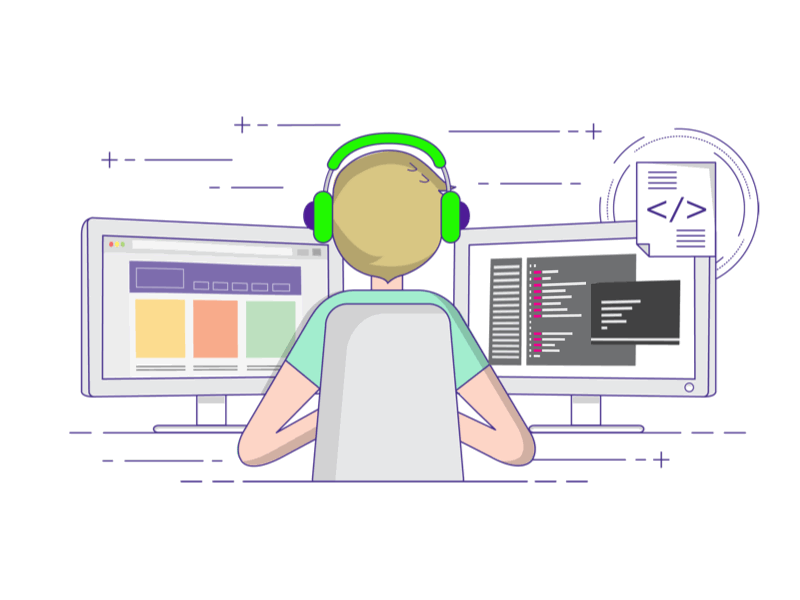
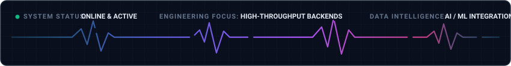

<h1 align="center">Hello Visitor 👋</h1>

  

  
  &nbsp;
  
  &nbsp;
  
  &nbsp;
  

---

### 👨‍💻 About Me

  

  I'm a full-stack developer passionate about backend systems, AI integration, and scalable software architecture.  
  
  • <b>Backend Architecture:</b> I design modular, plugin-based services and REST/GraphQL APIs that scale reliably. 
  • <b>AI &amp; Data Engineering:</b> I build custom ML pipelines and integrate intelligent LLM-driven features into products. 
  • <b>Search &amp; Optimization:</b> I optimize database schemas, caching layers, and search indexing for fast response times. 
  • <b>Full-Stack Delivery:</b> I connect resilient server architectures with clean, responsive user interfaces.

 

---

### ⚡ Languages &amp; Technologies

#### 🔹 Core Languages &amp; Runtimes
<table align="center">
  <tr>
    <td align="center" width="110">
      
       <b>Python</b>
    </td>
    <td align="center" width="110">
      
       <b>TypeScript</b>
    </td>
    <td align="center" width="110">
      
       <b>JavaScript</b>
    </td>
    <td align="center" width="110">
      
       <b>Java</b>
    </td>
    <td align="center" width="110">
      
       <b>C++</b>
    </td>
  </tr>
</table>

#### 🔹 Frameworks, APIs &amp; State
<table align="center">
  <tr>
    <td align="center" width="110">
      
       <b>React / Next</b>
    </td>
    <td align="center" width="110">
      
       <b>Django</b>
    </td>
    <td align="center" width="110">
      
       <b>Redux</b>
    </td>
    <td align="center" width="110">
      
       <b>GraphQL</b>
    </td>
    <td align="center" width="110">
      
       <b>REST APIs</b>
    </td>
  </tr>
</table>

#### 🔹 DevOps, Cloud &amp; Databases
<table align="center">
  <tr>
    <td align="center" width="110">
      
       <b>Docker</b>
    </td>
    <td align="center" width="110">
      
       <b>Kubernetes</b>
    </td>
    <td align="center" width="110">
      
       <b>AWS</b>
    </td>
    <td align="center" width="110">
      
       <b>MySQL</b>
    </td>
    <td align="center" width="110">
      
       <b>Nginx</b>
    </td>
    <td align="center" width="110">
      
       <b>GitHub CI/CD</b>
    </td>
  </tr>
</table>

#### 🔹 Specialized Backend &amp; AI Stack

  

  
  
  
  
  
  

---

### 📊 Telemetry &amp; Activity

  

  

  

---

### 🤝 Let's Connect &amp; Collaborate

  Always open to discussing <b>backend architecture</b>, <b>AI integrations</b>, or collaborating on impactful engineering projects.

  
  &nbsp;
  

